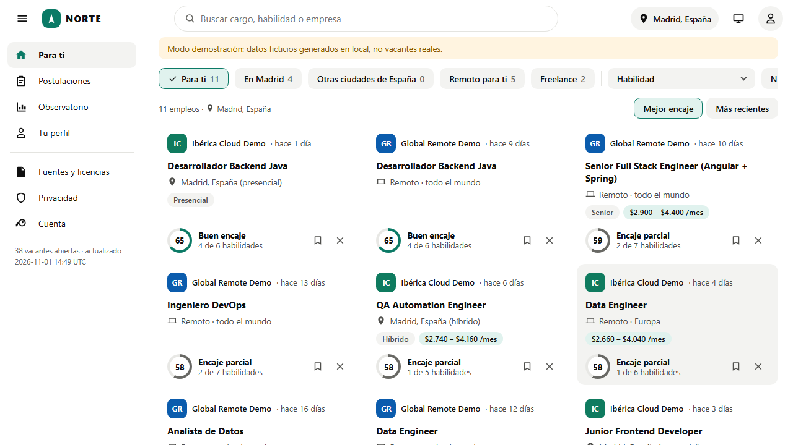
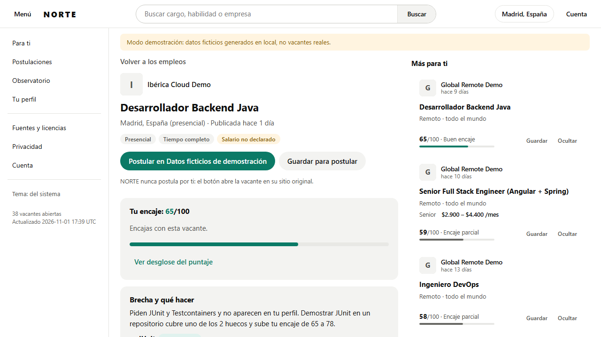
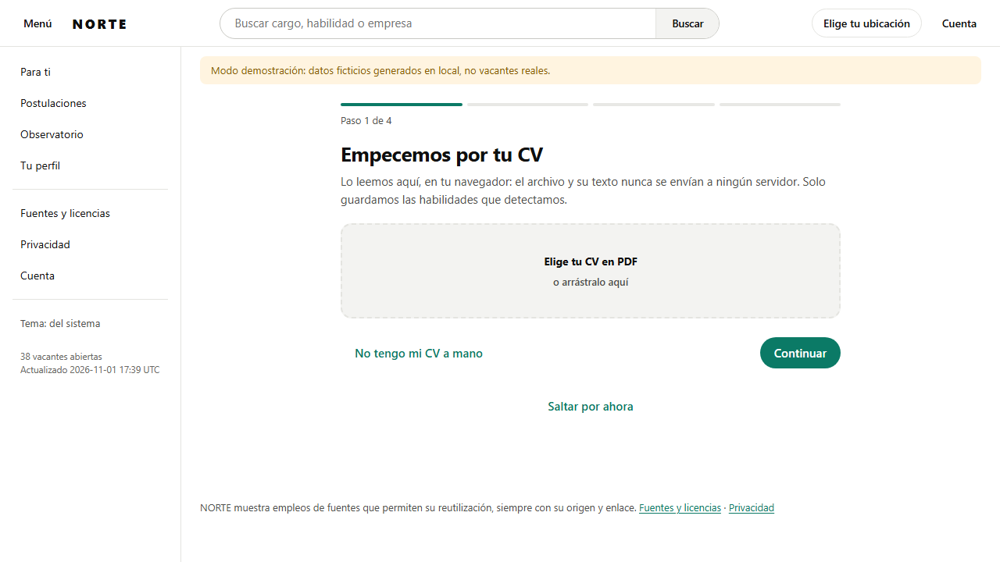
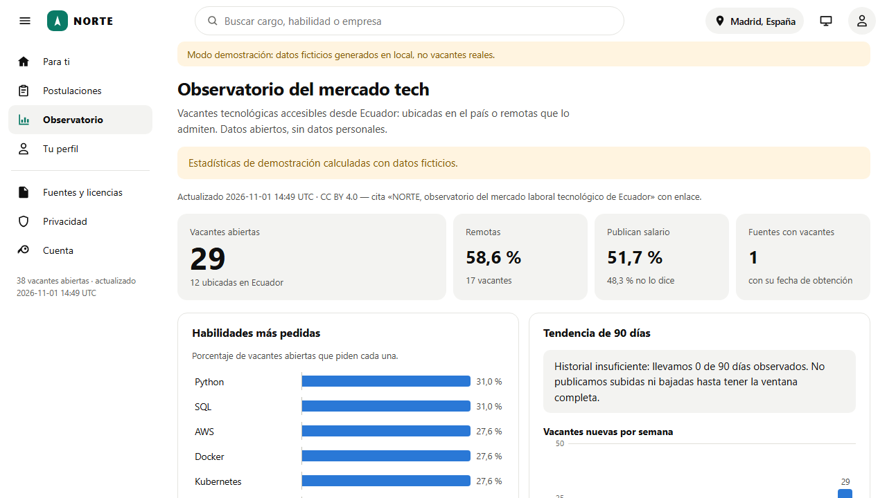
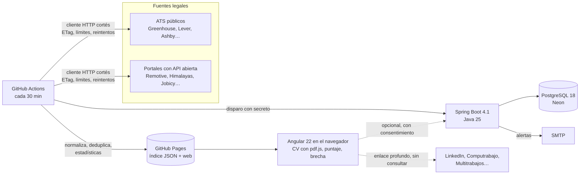
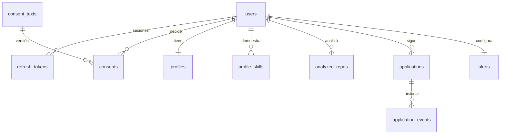

# NORTE

**Empleos de tecnología cerca de ti, en tu país o remotos que te admiten: con tu encaje explicado, lo que te falta y un observatorio público del mercado.** Tu CV se lee en tu navegador y nunca se envía.

[](https://github.com/DiegoFranciscoG/norte/actions/workflows/ci.yml)
[](https://github.com/DiegoFranciscoG/norte/actions/workflows/ingest.yml)


[](https://diegofranciscog.github.io/norte/)

## Demo en vivo

- **Sitio**: <https://diegofranciscog.github.io/norte/>, con vacantes reales que se actualizan en cada ingesta.
- **Usuario de prueba**: no hace falta. Todo funciona sin cuenta: el perfil vive en tu navegador. La cuenta es opcional y solo sirve para sincronizar postulaciones y recibir alertas.

## Capturas

| Para ti | Ficha con encaje y brecha |
|---|---|
|  |  |

| Ingreso guiado | Observatorio |
|---|---|
|  |  |

Las capturas usan el índice de demostración (empresas y vacantes ficticias).

## Problema que resuelve

Buscar empleo tech obliga a revisar decenas de portales, sin saber si una vacante remota te admite desde tu país ni por qué encajas o no. Los portales grandes prohíben reutilizar sus avisos, y casi nadie publica datos abiertos del mercado. NORTE junta solo fuentes que permiten reutilización, calcula tu encaje con una fórmula pública y te dice qué te falta y cómo cubrirlo.

## Funcionalidades

- **Global y relativo a ti**: indicas tu país y ciudad (o pulsas «Usar mi ubicación»: la ciudad más cercana se calcula en tu navegador). Presencial e híbrido se buscan en tu país, primero en tu ciudad; remoto, en empresas de cualquier país que admitan el tuyo.
- **Ingreso guiado**: CV → revisar datos → ubicación → modalidades (presencial, híbrido, remoto).
- **Vista previa al pasar el cursor**: cada vacante despliega su descripción breve, lo que pide y qué tienes o te falta, sin abrirla.
- **Interfaz sin íconos y con logos reales** de las empresas cuando la fuente los entrega (descargados y validados en la ingesta, servidos desde el propio sitio).
- **Encaje 0–100 explicado**: siete componentes con pesos públicos y ajustables; el desglose suma exactamente el total ([docs/algoritmo.md](docs/algoritmo.md)).
- **Brecha accionable**: qué habilidades faltan, cuánto subiría tu encaje al demostrarlas, cuál de tus repositorios está más cerca y un recurso verificado para aprender.
- **Evidencia de GitHub**: distingue habilidades demostradas en tu código (pesan el doble) de las declaradas en el CV.
- **Siempre al día**: la ingesta corre cada 30 minutos; la web revisa cada 5 y, cuando hay 10 empleos nuevos para ti, muestra «Aparecieron 10 empleos nuevos · Recargar».
- **Postulaciones**: tablero con estados (guardada, postulada, respondió, entrevista, oferta, rechazada), notas y recordatorios.
- **Observatorio público** del mercado accesible desde Ecuador: habilidades más pedidas, tendencia de 90 días, Cuenca / Quito / Guayaquil, % remoto, salarios por rol y nivel, informes mensuales automáticos, CSV y API de solo lectura (CC BY 4.0).
- **Alertas por correo** (opcionales, con consentimiento): solo vacantes nuevas sobre tu umbral, de tus modalidades y que puedes tomar desde tu país.
- **Privacidad por diseño (LOPDP)**: consentimiento por finalidad, exportación de todos tus datos y borrado real de la cuenta.

## Arquitectura



El índice público no tiene datos personales y no necesita servidor: búsqueda, puntaje y brecha corren en el navegador. La API solo guarda lo privado (cuenta, perfil por identificadores, postulaciones, alertas, consentimientos).

## Stack y por qué

| Pieza | Elección | Por qué |
|---|---|---|
| Lógica compartida | TypeScript 6 (`packages/core`) | La misma extracción de habilidades y el mismo puntaje en la ingesta y en el navegador |
| Ingesta | Node 26 + GitHub Actions | Gratis, programable cada 30 min, publica directo en Pages |
| Web | Angular 22 (zoneless, signals, standalone) | Rendimiento sin zone.js, carga diferida por ruta, PWA sin conexión |
| Búsqueda | MiniSearch | Índice de texto completo precompilado, búsqueda instantánea sin servidor |
| CV | pdf.js en el navegador | El CV nunca sale del dispositivo (T-05) |
| API | Java 25 + Spring Boot 4.1 | Spring Security 7, validación, Flyway, ProblemDetail, OpenAPI |
| Base de datos | PostgreSQL 18 (Neon) | Restricciones `CHECK`, `citext`, `jsonb`, borrado en cascada (T-09) |
| Pruebas | Vitest, JUnit 5, Testcontainers, Playwright | PostgreSQL real en integración (nunca H2) |

## Modelo de datos



Detalle completo, reglas y fuentes en [docs/modelo-datos.md](docs/modelo-datos.md). Migraciones: `api/src/main/resources/db/migration` (Flyway V1–V3).

## Cómo ejecutar en local

### Con Docker

```bash
cp .env.example .env
```

Completa `DB_PASSWORD`, `JWT_SECRET` (`openssl rand -base64 48`) y `ALERTS_TRIGGER_TOKEN` (`openssl rand -hex 32`); sin ellos no arranca.

```bash
docker compose up --build
```

Web en <http://localhost:8081> (índice de demostración con datos ficticios), API en <http://localhost:8080> (Swagger en `/swagger-ui.html`), correos de prueba en <http://localhost:8025>.

### Sin Docker

Requisitos: Node 26, Java 25 y PostgreSQL 18.

```bash
npm ci
```

```bash
npm run ingest:demo
```

```bash
npm start -w @norte/web
```

Para la ingesta real (consulta las fuentes con sus límites): `npm run ingest`. Para la API, con las variables de `.env.example` exportadas:

```bash
cd api && ./mvnw spring-boot:run
```

## Variables de entorno

| Variable | Obligatoria | Uso |
|---|---|---|
| `DB_URL`, `DB_USER`, `DB_PASSWORD` | Sí | Conexión a PostgreSQL |
| `JWT_SECRET` | Sí | Secreto HS256 de al menos 256 bits; si falta o es corto, la API no arranca |
| `ALERTS_TRIGGER_TOKEN` | Sí | Secreto compartido con GitHub Actions para disparar alertas (≥ 32 caracteres) |
| `CORS_ALLOWED_ORIGINS` | Sí | Orígenes permitidos, separados por coma (nunca `*`) |
| `CLIENT_IP_HEADER` | No | Cabecera con la IP real del visitante, solo si un proxy de confianza la sobrescribe siempre |
| `NORTE_INDEX_BASE_URL` | Sí | Dónde está el índice público (`…/data/v1`) |
| `NORTE_SITE_URL` | No | Enlaces de los correos de alerta |
| `SMTP_HOST`, `SMTP_PORT`, `SMTP_USERNAME`, `SMTP_PASSWORD`, `ALERTS_FROM` | No | Envío de alertas |
| `NORTE_API_URL` | No | URL de la API que usa la web: variable del contenedor nginx o, en GitHub Pages, variable del repositorio |
| `APP_PORT`, `OPENAPI_ENABLED` | No | Puerto y Swagger (desactivado por defecto) |

En GitHub: `NORTE_ALERTS_URL` y `NORTE_ALERTS_TRIGGER_TOKEN` como *secrets* del repositorio (opcionales).

## API

Documentación OpenAPI en `/swagger-ui.html` (con `OPENAPI_ENABLED=true`) y ejemplos listos en [docs/api.http](docs/api.http).

| Método | Ruta | Descripción |
|---|---|---|
| POST | `/api/v1/auth/register` | Crear cuenta con consentimientos separados y desmarcados |
| POST | `/api/v1/auth/login`, `/refresh`, `/logout` | Token de acceso de 15 min y refresco rotativo con detección de reuso |
| GET | `/api/v1/consent-texts` | Textos vigentes por finalidad |
| GET/PUT | `/api/v1/me/profile`, `/skills`, `/repos` | Perfil: país, ciudad, modalidades e identificadores de habilidades (nunca el CV) |
| GET/PUT | `/api/v1/me/consents/{purpose}` | Otorgar o retirar (retirar borra los datos de esa finalidad) |
| GET/PUT | `/api/v1/me/alerts` | Alertas por correo |
| CRUD | `/api/v1/me/applications` | Postulaciones con historial de estados |
| GET | `/api/v1/me/export` | Todos tus datos en JSON |
| DELETE | `/api/v1/me` | Borrado real de la cuenta |

El observatorio tiene su propia API pública de solo lectura (archivos estáticos): [docs/observatorio.md](docs/observatorio.md).

## Tests y cobertura

| Suite | Qué cubre | Resultado |
|---|---|---|
| Vitest (núcleo + ingesta) | T-01 fuentes prohibidas, T-02 deduplicación, T-03 puntaje con casos calculados a mano, T-04 brecha (300 combinaciones), T-06 límites, T-07 fuente caída, T-08 atribución, T-10 sin datos personales en estadísticas, alcance remoto y publicaciones repetidas por ciudad | 181 pruebas · 93 % de sentencias |
| JUnit 5 | Los mismos casos de puntaje que TypeScript, límite de intentos, IP detrás de un proxy, JWT, correo escapado | 29 pruebas |
| Testcontainers (PostgreSQL 18 real) | Autenticación y reuso de tokens, seguridad y cabeceras, consentimientos, postulaciones, alertas, **T-09 borrado real**, servidor real detrás de un proxy | 24 pruebas · servicios 92 %, puntaje 96 % |
| Playwright | **T-05 el CV no sale del navegador**, flujo global (Madrid y Cuenca), aviso de recarga, observatorio. Se repiten contra el build que se publica, con subruta, CSP, service worker y sin conexión | 8 pruebas en desarrollo y 13 contra el sitio publicable |
| Vitest (Angular) | Formatos de la interfaz | 4 pruebas |

```bash
npm run test:coverage
```

```bash
cd api && ./mvnw -Pcoverage verify
```

CI exige cobertura mínima (80 % en TypeScript; 70 % en servicios y puntaje Java), corre gitleaks sobre todo el historial, y construye y levanta todo con Docker Compose.

## Despliegue

Todo en planes gratuitos:

- **Web e índice**: GitHub Pages con «GitHub Actions» como origen, publicado por `.github/workflows/ingest.yml` cada 30 minutos. Pages no limita las publicaciones hechas con un workflow propio; el sitio cabe holgadamente en el límite de 1 GB. Como Pages no permite cabeceras propias, la CSP viaja en un `<meta>` (`web/scripts/build-pages.mjs`).
- **API** (opcional: sin ella, la web funciona sin cuentas): Render (plan gratuito, se duerme tras 15 minutos sin tráfico: la primera llamada tarda unos segundos), imagen `api/Dockerfile`, con `CORS_ALLOWED_ORIGINS=https://diegofranciscog.github.io`, `NORTE_INDEX_BASE_URL=https://diegofranciscog.github.io/norte/data/v1`, `NORTE_SITE_URL=https://diegofranciscog.github.io/norte` y `CLIENT_IP_HEADER=CF-Connecting-IP`. Para que la web la use, crea en GitHub la variable de repositorio `NORTE_API_URL` con su origen https.
- **Base de datos**: Neon (0,5 GB por proyecto), sin la expiración de 30 días del Postgres gratuito de Render.
- **Alertas**: el workflow de ingesta llama a la API al terminar, así el servidor gratuito solo despierta cuando hay vacantes nuevas.
- **Mantenimiento**: en un repositorio público, GitHub apaga los workflows programados tras 60 días sin actividad. Si la ingesta se detiene, se reactiva con `gh workflow enable ingest.yml`.

## Seguridad aplicada

- Spring Security deny-by-default; solo registro, login, refresco, textos de consentimiento y `health` son públicos.
- Argon2id para contraseñas; JWT HS256 de 15 minutos con secreto ≥ 256 bits desde el entorno; refresco rotativo guardado como hash, con revocación de toda la sesión si se reutiliza; tokens de una cuenta borrada inválidos al instante.
- Límite de intentos por correo y, más holgado, por IP real del visitante detrás del proxy (429 con `Retry-After`); también limita la creación masiva de cuentas. Bean Validation en todos los DTO; errores RFC 9457 sin trazas; Actuator solo `health`.
- CORS con orígenes explícitos; cabeceras CSP, `X-Frame-Options`, `nosniff`, `Referrer-Policy` y HSTS; la web sin scripts en línea (`script-src 'self'`), con la misma CSP en nginx y en GitHub Pages.
- Registros sin direcciones de correo: de un envío fallido solo se guarda el tipo de error.
- SQL solo parametrizado (JPA); `ddl-auto: validate` contra las migraciones.
- CSV publicados con neutralización de fórmulas (inyección CSV).
- Logos validados por firma de bytes y tamaño (nunca SVG) y servidos desde el propio sitio: el navegador no contacta a terceros.
- Docker multi-etapa, imágenes con versión fija, usuario no root y healthcheck; GitHub Actions con permisos mínimos y acciones fijadas por SHA.
- Sin secretos en el repositorio: gitleaks en pre-commit y en CI.

## Decisiones técnicas

- **Índice estático en lugar de un backend de búsqueda**: cero costo, sin servidor que mantener y privacidad por construcción (el puntaje se calcula en el navegador).
- **Grupos relativos a cada persona, no al índice**: el índice guarda a quién admite cada remoto (regiones y países); el navegador decide qué le sirve a cada uno. Así un solo índice sirve a cualquier país.
- **Ubicación sin servidor**: las coordenadas se convierten en la ciudad más cercana dentro del navegador (GeoNames); solo se guarda país y ciudad.
- **Mismo puntaje en TypeScript y Java**: validado con los mismos casos calculados a mano (`data/fixtures/scoring-cases.json`), así las alertas por correo y la web nunca discrepan.
- **«Tiempo real» honesto**: las fuentes no avisan cuando publican; consultar cada 30 minutos respetando el límite de cada una es lo más cercano y legal.
- **Series mensuales congeladas**: el estado guarda unos 90 días; un mes cerrado no se recalcula y el primer mes se marca como tal.
- **El título manda sobre la etiqueta del portal**: «Anywhere in the World» no anula un «United States» o «Remote in Europe» en el título, para no recomendar lo que la persona no puede tomar.
- **Una vacante por ciudad**: si un tablero repite la misma publicación en varias ciudades, cada una es una vacante con su propio id estable; así aparece en «cerca de ti» para quien vive allí.
- **El registro avisa si el correo ya existe**: sin verificación por correo no hay otra forma de explicar por qué no se crea la cuenta. Es una decisión consciente: queda limitado por correo y por IP, y el login no delata cuentas (ni por mensaje ni por tiempo de respuesta).

## Roadmap

- Más fuentes presenciales fuera de Latinoamérica con API oficial y clave (por ejemplo Adzuna), que requieren registro.
- Interfaz en inglés y portugués.
- Observatorio por país además del de Ecuador.
- Cargar mallas universitarias oficiales para la brecha academia–mercado.

## Fuentes de datos y licencias

- Vacantes: APIs públicas de ATS (Greenhouse, Lever, Ashby, Workable, Recruitee, SmartRecruiters, Teamtailor) y portales que permiten reutilización con atribución (Remote OK, Remotive, Himalayas, We Work Remotely, Arbeitnow, Jobicy, Get on Board). Cada vacante muestra su fuente, la fecha en que se obtuvo y el enlace al original. Términos y límites verificados en [docs/fuentes.md](docs/fuentes.md).
- Excluidas por sus términos (solo enlace profundo, nunca consultas): LinkedIn, Multitrabajos, Computrabajo y otras ([docs/fuentes.md](docs/fuentes.md)).
- Habilidades: catálogo propio enlazado a ESCO v1.2.1 (© Unión Europea).
- Ciudades: GeoNames (CC BY 4.0). Nombres de países: Unicode CLDR. División político-administrativa de Ecuador: INEC.
- Logos de empresas: solo los que entregan Himalayas y Get on Board en sus datos ([docs/fuentes.md](docs/fuentes.md#11-logos-de-empresas)).
- Tipos de cambio: Banco Central Europeo.
- Estadísticas del observatorio: CC BY 4.0. Código: MIT.
- Investigación y supuestos: [docs/investigacion.md](docs/investigacion.md) · Cumplimiento LOPDP: [docs/legal.md](docs/legal.md).

## Autor

**Diego Francisco Granda Zhingre** · Cuenca, Ecuador
[GitHub](https://github.com/DiegoFranciscoG) · [LinkedIn](https://www.linkedin.com/in/diego-francisco-g-61b793254/) · [Portafolio](https://diegofranciscog.github.io/)
