# Modelo de datos

NORTE separa dos mundos que nunca se mezclan:

| | Índice público | Base privada |
|---|---|---|
| Qué guarda | Vacantes normalizadas, catálogo de habilidades, configuración del puntaje, estadísticas | Cuentas, perfil (solo identificadores de habilidades), postulaciones, alertas, consentimientos, auditoría |
| Dónde vive | JSON estático en GitHub Pages (`/data/v1/`) | PostgreSQL 18 (Neon en producción) |
| Quién escribe | La ingesta (GitHub Actions cada 3 h) | La API Spring Boot |
| Datos personales | **Ninguno** (lo comprueban T-01 y T-10) | Sí, con consentimiento por finalidad (LOPDP) |
| Esquema | `packages/core/src/types.ts` | Migraciones Flyway en `api/src/main/resources/db/migration` |

El CV y el texto completo de los repositorios **nunca** salen del navegador: se analizan ahí y solo se guardan (si la persona lo consiente) los identificadores de habilidades resultantes.

## 1. Base privada (PostgreSQL)

```mermaid
erDiagram
    users ||--o{ refresh_tokens : "sesiones"
    users ||--o{ consents : "decide"
    users ||--|| profiles : "tiene"
    users ||--o{ profile_skills : "declara o demuestra"
    users ||--o{ analyzed_repos : "analizó"
    users ||--o{ applications : "sigue"
    applications ||--o{ application_events : "historial"
    users ||--|| alerts : "configura"
    users |o--o{ audit_log : "genera"
    consent_texts ||--o{ consents : "versión aceptada"

    users {
        uuid id PK
        citext email UK "3 a 254 caracteres"
        varchar password_hash "Argon2id"
        timestamptz created_at
        timestamptz last_login_at
    }
    refresh_tokens {
        uuid id PK
        uuid user_id FK
        varchar token_hash UK "SHA-256 del token; nunca el token"
        uuid family_id "rotación y detección de reuso"
        timestamptz expires_at
        timestamptz revoked_at
    }
    consent_texts {
        varchar purpose PK "PROFILE_STORAGE | EMAIL_ALERTS"
        varchar version PK
        varchar text
        date published_at
        boolean is_current
    }
    consents {
        uuid id PK
        uuid user_id FK
        varchar purpose "CHECK"
        varchar text_version
        boolean granted
        timestamptz decided_at "solo inserciones"
    }
    profiles {
        uuid user_id PK, FK
        varchar home_country "ISO 3166-1 alfa-2"
        varchar home_city "opcional"
        jsonb modalities "onsite, hybrid, remote"
        boolean accepts_relocation
        numeric years_of_experience "0 a 50"
        varchar english_level "A1..C2 (MCER)"
        integer min_salary_usd
        jsonb weights "pesos personalizados del puntaje"
        varchar github_user
    }
    profile_skills {
        uuid id PK
        uuid user_id FK
        varchar skill_id "id del catálogo"
        varchar esco_uri "ESCO v1.2.1 si existe"
        varchar origin "DEMONSTRATED | DECLARED"
        jsonb repos "nombres de repos que la demuestran"
    }
    analyzed_repos {
        uuid id PK
        uuid user_id FK
        varchar name
        varchar url "https://github.com/..."
        timestamptz pushed_at
        jsonb skills
    }
    applications {
        uuid id PK
        uuid user_id FK
        varchar job_id "id del índice público"
        varchar job_title
        varchar company
        varchar status "SAVED..REJECTED"
        date applied_at
        date follow_up_at "recordatorio"
        varchar notes "hasta 4000"
    }
    application_events {
        uuid id PK
        uuid application_id FK
        varchar status
        timestamptz changed_at
    }
    alerts {
        uuid user_id PK, FK
        boolean enabled
        integer min_score "0 a 100"
        varchar last_index_version
        timestamptz last_run_at
        timestamptz last_sent_at
    }
    audit_log {
        bigserial id PK
        uuid user_id FK "NULL en el evento de borrado"
        varchar action
        timestamptz at
        varchar detail "sin datos personales"
    }
```

### Reglas de negocio y de dónde salen

| Regla | Dónde se aplica | Fuente |
|---|---|---|
| Toda tabla con datos de una persona cuelga de `users` con `ON DELETE CASCADE`; borrar la cuenta borra todo (T-09) | `V1__init.sql`, `AccountService.delete` | LOPDP art. 15 (eliminación) — ver [legal.md](legal.md) |
| El consentimiento es por finalidad, explícito, desmarcado por defecto y guarda la versión del texto aceptado | `consents`, `consent_texts`, `ConsentService` | LOPDP art. 8 |
| Retirar `PROFILE_STORAGE` borra habilidades, repositorios y preferencias; retirar `EMAIL_ALERTS` apaga las alertas | `AccountService.changeConsent` | LOPDP arts. 8 y 16 |
| Solo se acepta la versión vigente del texto: nadie consiente un texto que no vio | `ConsentService.decide` | LOPDP art. 8 (consentimiento informado) |
| Exportación completa en JSON estructurado | `GET /api/v1/me/export` | LOPDP arts. 13 (acceso) y 17 (portabilidad) |
| La auditoría no guarda correos ni contenido; el borrado deja solo un evento anónimo | `AuditService`, `audit_log.user_id NULL` | LOPDP art. 10 (minimización) |
| Contraseñas con Argon2id; tokens de refresco guardados como hash SHA-256 | `SecurityConfig`, `TokenService` | OWASP Password Storage Cheat Sheet; OWASP ASVS V2 |
| Nivel de inglés en la escala A1–C2 | `CHECK` en `profiles.english_level` | Marco Común Europeo de Referencia (MCER), Consejo de Europa |
| Habilidades enlazadas a ESCO cuando hay equivalente exacto | `profile_skills.esco_uri` | ESCO v1.2.1 (fuentes 18 y 19 de [investigacion.md](investigacion.md)) |
| Estados de postulación: guardada, postulada, respondió, entrevista, oferta, rechazada | `CHECK` en `applications.status` | Requisito del proyecto |
| Correo único sin importar mayúsculas | `citext` + `UNIQUE` | Requisito del proyecto |

### Migraciones

| Versión | Contenido |
|---|---|
| `V1__init.sql` | Esquema completo con restricciones `CHECK`, `UNIQUE`, claves foráneas en cascada e índices |
| `V2__consent_texts.sql` | Textos de consentimiento vigentes (versión `2026-10`) |
| `V3__global_location.sql` | País de residencia, ciudad opcional y modalidades preferidas (NORTE pasa a ser global) |

Hibernate corre con `ddl-auto: validate`: si una entidad y la migración no coinciden, la API no arranca. Las pruebas de integración lo comprueban contra PostgreSQL real (Testcontainers), nunca H2.

### Datos de ejemplo

La base no trae personas de ejemplo: las cuentas se crean desde la interfaz. El índice de demostración (`npm run ingest:demo`) genera vacantes **ficticias** (empresas y títulos inventados, marcados con `demo: true`), sin ningún dato personal.

## 2. Índice público (JSON estático)

```mermaid
erDiagram
    INDEX ||--o{ JOB : "jobs.json"
    JOB ||--|{ JOB_SOURCE_REF : "fuentes (tras deduplicar)"
    JOB ||--o{ JOB_SKILL : "pide"
    JOB_SKILL }o--|| SKILL_DEF : "catálogo (skills.json)"
    SKILL_DEF }o--o| ESCO_SKILL : "equivalente exacto"
    JOB ||--o| SALARY : "si la fuente lo publica"
    JOB ||--o{ LANGUAGE_REQUIREMENT : "idiomas"
    INDEX ||--o{ SOURCE_RUN : "estado de cada fuente"

    INDEX {
        string build_version
        string generatedAt
        boolean demo
        object totals "por grupo: casa, Ecuador, remoto, freelance"
        object license
    }
    JOB {
        string id PK "hash estable de publicación y huella"
        string title
        string company_name
        string city "INEC DPA"
        string country "ISO 3166-1 alfa-2"
        string modality "onsite | hybrid | remote | unknown"
        string remoteScope "worldwide | regions | countries | unknown"
        array remoteRegions "latam, americas, europe, emea, apac…"
        array remoteCountries "ISO 3166-1 alfa-2"
        string seniority
        number yearsRequired
        boolean yearsInferred "supuesto S-05"
        string publishedAt
        string firstSeenAt
        string lastSeenAt
        string status "open | closed"
        string excerpt "sin correos ni teléfonos"
    }
    JOB_SOURCE_REF {
        string sourceId
        string externalId
        string url "enlace al original"
        string applyUrl
        object attribution "texto y enlace exigidos por la fuente"
        boolean allowInAlerts "Remotive: false"
        string fetchedAt "fecha en que se obtuvo"
    }
    SALARY {
        number min
        number max
        string currency "ISO 4217"
        string period "hour | day | week | month | year"
        number usdMonthlyMin
        number usdMonthlyMax
        object fx "fuente BCE, fecha y tasa"
    }
    LANGUAGE_REQUIREMENT {
        string language "ISO 639-1"
        string level "A1..C2 o null"
        boolean inferred
    }
    SKILL_DEF {
        string id PK
        string name
        string category
        array aliases "en español e inglés"
        array implies "spring-boot implica java"
    }
```

### Reglas del índice y su fuente

| Regla | Fuente |
|---|---|
| Cada vacante conserva la URL original, la fuente y la fecha en que se obtuvo (`fetchedAt`) | Requisito «nada inventado»; términos de cada fuente ([fuentes.md](fuentes.md)) |
| LinkedIn, Multitrabajos y Computrabajo solo aparecen como enlaces profundos de búsqueda; ningún cliente HTTP contra sus dominios (T-01) | Sus términos y `robots.txt` (fuentes 14–16) |
| Remotive: atribución visible, máximo 4 consultas al día y fuera de las alertas | Términos de su API (fuente 7) |
| Salarios convertidos a USD mensual con la tasa de referencia del BCE y su fecha; hora → mes con 173,33 h | Fuente 21; supuesto S-04 |
| Ciudades y provincias de Ecuador con la división político-administrativa del INEC; el resto del mundo con las ciudades de GeoNames y los nombres de país de CLDR | Fuentes 22, 31 y 32 |
| Una vacante entra al índice si se puede ubicar (remota, o con país conocido); el grupo «cerca de ti / tu país / remoto para ti» se calcula para cada persona | [algoritmo.md](algoritmo.md) |
| Extractos sin correos, teléfonos ni URLs de contacto | LOPDP art. 10 (minimización) |
| Una vacante que deja de aparecer en su fuente se marca `closed` con fecha, no se borra en silencio | Requisito del proyecto |
| Duplicados entre fuentes se fusionan conservando todas las referencias (T-02) | [algoritmo.md](algoritmo.md) |
